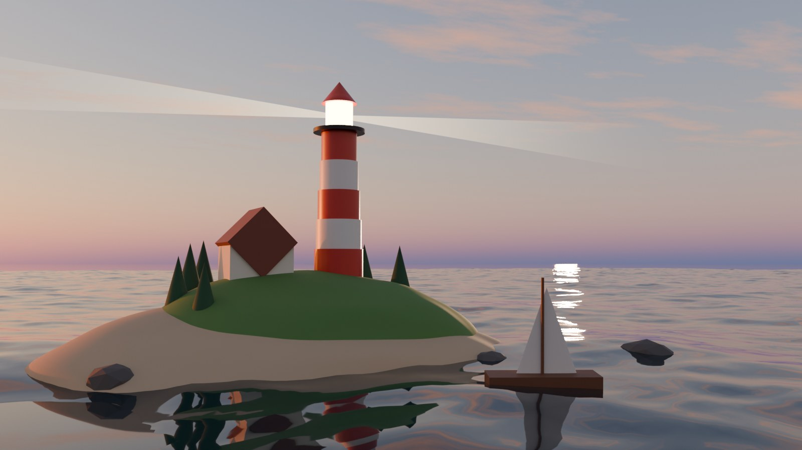
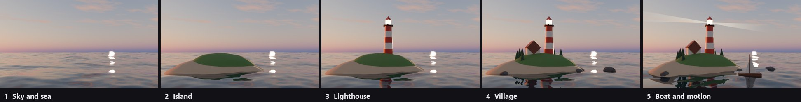

# Lighthouse island



Five `execute` calls build this scene from an empty file. Each JSON file is one call, exactly as an
agent sends it. Claude wrote them while iterating on the look with `capture` previews.



| Call | What it adds | Operations | Argument tokens | Result tokens |
|---|---|---:|---:|---:|
| [01-sky-and-sea.json](01-sky-and-sea.json) | GPU setup, sunset sky, ocean modifier, sun, camera, cloud layer | 15 | 1,187 | 55 |
| [02-island.json](02-island.json) | Sand and grass mounds, subdivision, noise displacement | 9 | 350 | 28 |
| [03-lighthouse.json](03-lighthouse.json) | Tapered striped tower, lantern, roof, beacon light | 24 | 775 | 28 |
| [04-village.json](04-village.json) | Keeper's house, 9 pines, 5 low-poly rocks | 43 | 1,352 | 28 |
| [05-boat-and-motion.json](05-boat-and-motion.json) | Sailboat, bobbing, rotating beam, moving waves | 18 | 1,353 | 63 |
| **Total** | | **109** | **5,017** | **202** |

Tokens are counted with tiktoken `o200k_base` over the compact JSON. The calls use the `python`
operation for the sky, cloud shader, island displacement, beam and parenting, so enable **python**
in the add-on panel before replaying.

## Replay

In Blender, start the bridge with **write**, **render** and **python** enabled on an empty scene, then:

```bash
for f in examples/lighthouse/0*.json; do uvx --from frugal-blender-mcp frugal-blender execute --params - < "$f"; done
uvx --from frugal-blender-mcp frugal-blender capture --params '{"filename":"lighthouse.png","size":1024}'
```

PowerShell:

```powershell
Get-ChildItem examples/lighthouse/0*.json | ForEach-Object { Get-Content -Raw $_ | uvx --from frugal-blender-mcp frugal-blender execute --params - }
```

Or headless from a clone, without touching your own Blender session. The host runs until you create
`demo-state/stop`, so start it in its own terminal:

```bash
blender -b --factory-startup --python scripts/demo_host.py -- ./demo-state
```

Then point the CLI at it:

```bash
export BLENDER_COMPACT_CONNECTION=./demo-state/connection.json
for f in examples/lighthouse/0*.json; do uv run frugal-blender execute --params - < "$f"; done
```

The scene animates over frames 1 to 96 and loops. It renders with Cycles on an OptiX GPU when one is
available and falls back to the CPU otherwise. Tested in Blender 5.1. Blender 4.x lacks the
multiple-scattering sky, so the batches fall back to the Nishita sky there and the light looks
different.
